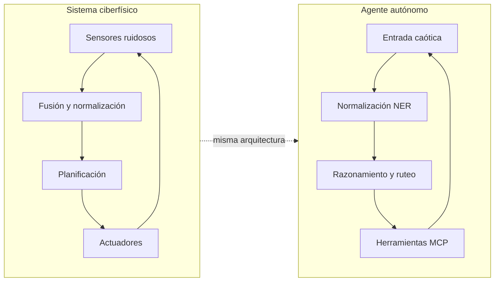
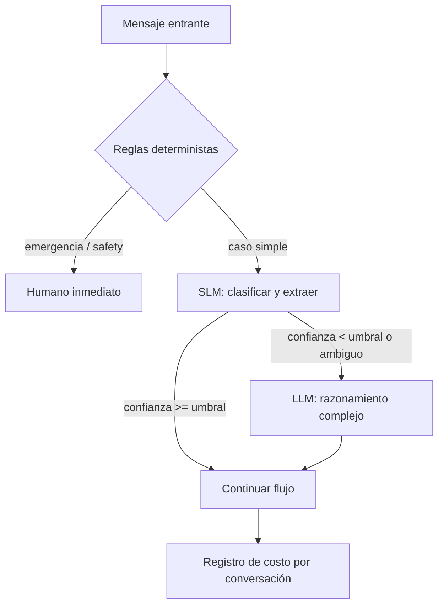
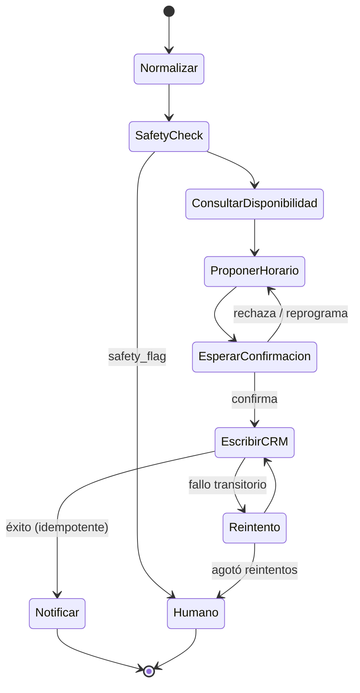

<div align="center">

# 🤖 Cyber-Physical Agents

### Arquitecturas de agentes de IA diseñadas con mentalidad de ingeniería mecatrónica

*Un agente de IA es un robot sin cuerpo: percibe un entorno ruidoso, decide con recursos limitados y actúa sobre sistemas reales. Yo aprendí a construirlos dentro de un invernadero.*


</div>

---

## ⚡ TL;DR (lectura de 30 segundos)

**Soy Eliot Romero**, estudiante de Ingeniería en Mecatrónica y Sistemas Ciberfísicos (Universidad Iberoamericana) y miembro de **Jada Robotics**, el equipo que ganó el **1.er lugar mundial en el Huawei ICT Competition 2025-2026** (Shenzhen, China, 33 países) con un robot agrícola autónomo que combina visión por computadora, edge AI, robótica móvil y realidad virtual.

Este repositorio traduce lo que aprendí sobre **sistemas que no pueden fallar en el mundo físico** a **agentes de IA que no pueden fallar en el mundo del negocio**: agendar un servicio, calificar un lead, responder a un cliente a las 11 pm.

**Qué demuestra este repo:**

| # | Competencia | Dónde verla |
|---|-------------|-------------|
| 1 | Convertir entradas caóticas en intención estructurada (NER + validación) | [`01-intent-normalization`](./01-intent-normalization) |
| 2 | Proteger el margen: SLM para rutear, LLM solo cuando el problema lo exige | [`02-cost-aware-router`](./02-cost-aware-router) |
| 3 | Flujos deterministas que no se rompen (LangGraph) | [`03-booking-agent-langgraph`](./03-booking-agent-langgraph) |
| 4 | Multiagente donde sí aporta valor: contenido y ventas (CrewAI) | [`04-sales-content-crew`](./04-sales-content-crew) |
| 5 | Herramientas y datos externos vía MCP, con permisos y esquemas | [`05-mcp-tools`](./05-mcp-tools) |

---

## 🧭 La tesis: un agente es un sistema de control con lenguaje

Antes de los frameworks de agentes existía la teoría de control. Los problemas son los mismos; cambió el sustrato.

| Mundo físico (Plague-Bot VR) | Mundo de agentes (este repo) |
|---|---|
| Sensor ruidoso: oclusión lumínica, hojas que tapan el fruto | Mensaje caótico del cliente: typos, spanglish, audio transcrito, 4 problemas en una frase |
| Fusión de sensores y normalización de señal | Extracción de intención y entidades (NER) → JSON validado con esquema |
| Inferencia en el borde con modelo cuantizado (INT8) | SLM barato para clasificar y rutear |
| Nube solo cuando el borde no alcanza | LLM robusto solo para razonamiento complejo |
| Lazo **Sense → Plan → Act** | Lazo **Reason → Act → Observe** |
| Controlador determinista y lógica de seguridad | Máquina de estados con LangGraph |
| Drivers y bus de hardware | Servidores MCP |
| Teleoperación humana vía VR (human-in-the-loop) | Escalación a un humano con contexto completo |
| Pérdida de red, watchdog, reintentos | Timeouts, idempotencia, *dead-letter queue* |



---

## 🏆 Caso de origen: Plague-Bot VR

Robot agrícola autónomo que **navega invernaderos de tomate**, **detecta plagas**, **diagnostica enfermedades fitopatológicas** y **evalúa el nivel de maduración** del fruto antes de la cosecha. Un agrónomo puede tomar control remoto mediante un gemelo digital en VR.

**El reto de ingeniería**

- Correr modelos de inferencia pesados en el borde, con **hardware limitado**.
- Mantener la precisión con **ruido visual y oclusión lumínica**.
- Conectar el edge con la **nube de Huawei** sin depender de una conexión perfecta.
- Decidir **qué se procesa en el borde y qué en la nube** para no desperdiciar cómputo.

**Stack y resultados** <!-- TODO: confirmar qué cifras quieres publicar -->

| Dimensión | Detalle |
|---|---|
| Visión | Dos modelos YOLOv8 cuantizados a INT8, optimizados con OpenVINO |
| Cómputo | Servidor edge (Intel NUC i7) + acelerador Hailo-8L + cámara RealSense |
| Latencia de inferencia | ~19.2 ms por cuadro (hasta ~80 FPS en INT8) |
| Confianza promedio en campo | 76.9 % |
| Teleoperación VR | 40-60 ms de latencia |
| Validación | Invernadero comercial de 20 ha en Oaxaca (red 4G y local) |
| Reconocimiento | 🥇 1.er lugar mundial, Huawei ICT Competition 2025-2026 |

**Lecciones que se transfieren directamente a agentes de IA**

1. **El dato sucio es la norma, no la excepción.** La calidad del agente la decide la capa de normalización, no el modelo más grande.
2. **No uses el procesamiento más caro por defecto.** Cuantizar y rutear fue lo que hizo viable el robot; rutear SLM → LLM es lo que hace viable un agente por suscripción.
3. **Lo crítico se resuelve con lógica determinista**, y el modelo generativo se reserva para lo ambiguo.
4. **Siempre hay una salida a un humano.**

---

## 🧱 Los tres pilares

### 1. Normalización de entradas caóticas → intención clara

> *Mismo problema que una cámara en un invernadero hostil: señal sucia, decisión limpia.*

Entrada real de un cliente:

```text
"hola se me tapo el lavabo de la cocina y ya llevo 2 dias asi, puedo mañana en la tarde?? vivo en narvarte, 
 ah y tmb huele raro como a gas no se si es lo mismo"
```

Salida estructurada y validada (Pydantic) que consume el resto del sistema:

```json
{
  "intent": "book_service",
  "service_type": "plumbing",
  "issue": "kitchen_sink_clog",
  "urgency": "high",
  "safety_flag": true,
  "safety_reason": "possible_gas_smell",
  "preferred_window": "tomorrow_afternoon",
  "location_hint": "Narvarte",
  "confidence": 0.91,
  "needs_human": true
}
```

Aquí `safety_flag` **no depende del criterio de un LLM**: una regla determinista lo dispara por palabras clave y patrones, y fuerza la escalación. Lo que puede costar una vida o una demanda no se delega a la probabilidad.

**Incluye:** esquemas Pydantic, normalizador híbrido (reglas + SLM), *dataset* de 100+ mensajes ruidosos y script de evaluación (`precision / recall` por campo).

### 2. Router consciente del costo: SLM primero, LLM por excepción

> *Mismo principio que el edge computing: resolver localmente lo que se pueda, escalar solo lo necesario.*



```python
# 02-cost-aware-router/router.py (versión conceptual)
def route(message: NormalizedMessage) -> ModelTier:
    if message.safety_flag:
        return ModelTier.HUMAN
    if message.confidence >= CONFIDENCE_THRESHOLD and message.intent in SIMPLE_INTENTS:
        return ModelTier.SLM          # ~centavos por cada mil conversaciones
    return ModelTier.LLM              # solo razonamiento complejo
```

**Incluye:** `cost_tracker` (tokens, USD y latencia por conversación), benchmark SLM-only vs LLM-only vs router híbrido, y un reporte de **costo de inferencia por cliente / mes**: la métrica que decide si una suscripción es rentable.

| Estrategia | Costo / 1,000 conv. | Exactitud de intención | p95 latencia |
|---|---|---|---|
| LLM siempre | _se llena con `make bench`_ | _…_ | _…_ |
| SLM siempre | _se llena con `make bench`_ | _…_ | _…_ |
| **Router híbrido** | _se llena con `make bench`_ | _…_ | _…_ |

### 3. Orquestación: la herramienta correcta para cada tipo de problema

| Criterio | **LangGraph** | **CrewAI** |
|---|---|---|
| Naturaleza del flujo | Estado explícito, pasos y transiciones definidos | Roles colaborativos con autonomía |
| Tolerancia a fallos | **Cero**: agendar, cobrar, escribir en el CRM | Media: se acepta variación |
| Auditabilidad | Alta (cada transición es trazable) | Media |
| Caso de uso en este repo | **AI Booking Agent / AI Secretary** | **AI Sales Agent** y generación de contenido |
| Analogía física | Controlador de seguridad del robot | Equipo de planeación de la misión |

**Regla de diseño:** si un error cuesta una cita perdida o un registro duplicado en el CRM, es un grafo de estados. Si el resultado es un texto que un humano revisa, es una *crew*.



**Incluye:** grafo completo con *checkpointing*, escrituras **idempotentes** al CRM (mock), reintentos con *backoff*, y pruebas que simulan fallos de red y respuestas duplicadas.

### Transversal: herramientas y datos con MCP

Los agentes alucinan menos cuando **consultan en lugar de inventar**. En [`05-mcp-tools`](./05-mcp-tools) hay un servidor MCP que expone el calendario y el CRM de ejemplo con:

- **Esquemas estrictos** de entrada y salida (el modelo no puede inventar campos).
- **Permisos por herramienta**: lectura separada de escritura.
- **Confirmación explícita** antes de acciones con efectos externos.
- **Registro de auditoría** de cada llamada.

---

## 🏠 Aplicado a servicios del hogar

| Vertical | Dolor típico | Cómo lo aborda este repo |
|---|---|---|
| Plomería | Urgencias, mensajes ambiguos, olor a gas | Normalización + regla de seguridad + escalación humana |
| Control de plagas | Cliente no sabe qué plaga tiene, recurrencia de servicio | Extracción de síntomas, agendamiento recurrente |
| Electricidad | Riesgo de seguridad, diagnóstico por descripción | Reglas de riesgo antes de cualquier respuesta generativa |
| HVAC | Picos de demanda estacionales, mantenimiento preventivo | Router barato para el volumen alto, LLM solo para casos complejos |

---

## 🚀 Playbook de despliegue en 48 horas

Un agente útil en dos días solo es posible con **plantillas, contratos claros y pruebas desde el día 0**. Ver [`deploy/48h-playbook.md`](./deploy/48h-playbook.md).

| Fase | Entregable |
|---|---|
| **Horas 0-8** | Mapeo del negocio: servicios, zonas, horarios, reglas de seguridad, CRM existente |
| **Horas 8-24** | Configuración de esquemas, conexión MCP/CRM, flujo de agendamiento en LangGraph |
| **Horas 24-40** | Evaluación con conversaciones reales anonimizadas; ajuste de umbrales del router |
| **Horas 40-48** | Despliegue en *shadow mode* (el agente sugiere, el humano aprueba) y tablero de costo/calidad |

---

## 📂 Estructura del repositorio

```text
cyberphysical-agents/
├── README.md
├── docs/
│   ├── 01-from-control-theory-to-agents.md
│   ├── 02-plaguebot-case-study.md
│   ├── 03-inference-cost-model.md
│   ├── 04-langgraph-vs-crewai.md
│   └── assets/
├── 01-intent-normalization/
├── 02-cost-aware-router/
├── 03-booking-agent-langgraph/
├── 04-sales-content-crew/
├── 05-mcp-tools/
├── evals/
├── deploy/
├── .github/workflows/ci.yml
├── pyproject.toml
├── .env.example
└── Makefile
```

---

## 🛠️ Quickstart

```bash
git clone https://github.com/<tu-usuario>/cyberphysical-agents.git
cd cyberphysical-agents
python -m venv .venv && source .venv/bin/activate
pip install -e ".[dev]"
cp .env.example .env          # agrega tus claves (o usa los modelos mock incluidos)

make demo-normalize           # intención estructurada desde un mensaje caótico
make demo-booking             # flujo de agendamiento completo con CRM simulado
make bench                    # compara costo y exactitud: LLM vs SLM vs router
make test                     # pruebas, incluyendo simulación de fallos
```

> Todos los demos corren **sin claves de API** usando modelos *mock* deterministas, para que cualquiera pueda reproducirlos.

---

## 📊 Evaluación y observabilidad

Un agente que no se mide es un robot sin telemetría. Cada módulo reporta:

- **Calidad:** exactitud de intención, F1 por entidad, tasa de escalación correcta.
- **Costo:** USD por conversación, por cliente y por mes.
- **Confiabilidad:** tasa de éxito de escritura al CRM, duplicados evitados, recuperación tras fallos.
- **Latencia:** p50 / p95 por tier de modelo.

---

## 🗺️ Roadmap

- [ ] Módulo de voz: transcripción ruidosa → normalización
- [ ] Evaluación con conversaciones reales anonimizadas
- [ ] Caché semántico para reducir llamadas repetidas
- [ ] Integración con un CRM real vía MCP

---

## 📫 Contacto

**Eliot Romero** · Ingeniería en Mecatrónica y Sistemas Ciberfísicos · Universidad Iberoamericana · Jada Robotics

[LinkedIn](https://www.linkedin.com/in/<tu-perfil>) · [Email](mailto:<tu-correo>) · [GitHub](https://github.com/<tu-usuario>)

<sub>Equipo Jada Robotics: Eliot Romero, Orlando Camacho, Adán López.</sub>
